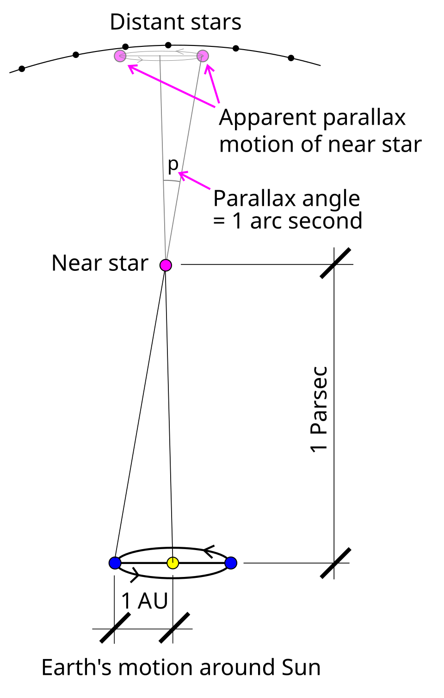
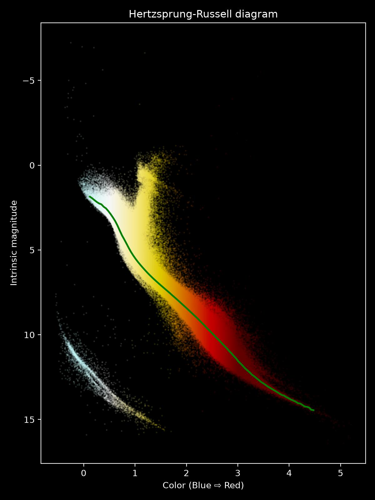

.. _numpy_stars:

NumPy
=====

.. questions::

   - Why and when should I use NumPy?
   - Why is NumPy faster than plain Python?
   - How do we frame scientific questions in terms of NumPy computations?
   - How do I translate a mathematical formula into a line of NumPy code?

.. objectives::

   This is not a complete NumPy tutorial. Instead, this lesson strives to teach you:

   - How to use basic NumPy: arrays, selecting data, performing mathematical operations
   - A sense of how NumPy code looks: vectorized code.
   - To understand enough of NumPy to search for answers to the rest of your questions. ;)

.. admonition:: Example context
   :class: demo

   This lesson is placed inside an example scientific setting.
   We will compute the distance of the stars in our night sky, using the data collected by the Gaia sattelite.
   To follow along, you must download the :download:`data package <https://drive.google.com/file/d/1ZbZIpf-tL60S18k9f8LI_YdTe9o8jy-I/view?usp=sharing>` and unzip it in the ``python-for-scicomp`` folder.

Why NumPy?
----------

NumPy is the most used library for scientific computing.
If NumPy did not exist, Python would not be such a popular language for scientific computing, because it would be too slow.
Even if you are not using it directly, chances are high that some library uses it in the background.
It helps you work with "data", as in large amounts of numbers, by providing:

1. A high-performance multidimensional array object to store data in computer memory
2. Efficient routines to manipulate data, such as reading and writing, splitting and concatenation, and other transformations
3. Efficient routines to perform computations on data, such as statistics and linear algebra

Let's explore the fundamentals of this foundational library by analyzing some astronomical data and discover the secret of the Large Magallanic Cloud.

.. highlight:: python

Part 1: Measuring distance through the parallax effect
------------------------------------------------------

The `Gaia sattelite <https://www.esa.int/Science_Exploration/Space_Science/Gaia>`__ has imaged around 1.8 billion stars and other objects.
Among the things it measured was the "parallax" of each object, which is how much it seems to "move" in relationship to very distant stars as the sattelite traveled around the sun and observed it from different angles.
We can use the amount of parallax to determine how far away a star is.

   Visual explanation of the parallax effect. Image `retrieved from WikiMedia <https://commons.wikimedia.org/wiki/File:Stellarparallax_parsec1.svg>`__. Public domain.

A sample of the Gaia data can be found in ``local_stars.csv``.
This is a *comma separated value (CSV)* file, where each line contains the parallax, magnitude and color of the star.
The first line of that file is the "header" containing the column names::

    parallax,magnitude,color
    0.006857487064725919,12.039392,1.2009865000000008
    0.002518501684985923,12.374151,1.0634999999999994
    0.0066604546553127855,12.95553,1.3955085
    0.00789357866196891,13.52746,2.180584999999999
    0.004043843423571794,12.745788,0.9782539999999997
    ...

We can use one of NumPy's functions to load the entire file into memory::

    import numpy as np  # we usually use `np` as shorthand

    # Set this to the location where you unzipped the data package.
    stars_filename = "../resources/data/numpy/local_stars.csv"

    # We set `skip_header=1` to skip the first line containing the column names.
    stars = np.genfromtxt(stars_filename, delimiter=",", skip_header=1)
    print(stars)

The ``stars`` variable is a NumPy array::

   print(type(stars))

What is an array?
-----------------

An array is a collection of values which are all of the same datatype, tightly packed side-by-side in a continuous chunk of memory.
This is why we had to skip the first line of the file, the one containing ``str`` type descriptions, so that we were only reading numbers.
In our case, the datatype of the resulting array is::

    print(stars.dtype)

Arrays can have any number of dimensions, ours has::

    print(stars.ndim)

You can think of a 1D array as a *list* and a 2D array as a *table*.
Alternatively, in mathematics, we call a 1D array a *vector*, a 2D array a *matrix*, and an array with 3 or even more dimensions a *tensor*.
An array can even have zero dimensions if it represents a single *scalar* number.
Regardless of how many dimensions the array has, it is always a Python object of type :class:`numpy.ndarray`.

Let's see how many stars we have. The ``.shape`` property of an array contains the size along each dimension::

    print(stars.shape)

We have information on more than a million stars, and for each star we have 6 values.

Working with arrays
-------------------

Here is the data, formatted as a table:

=========== ========= ==============
parallax    magnitude color
=========== ========= ==============
0.006857487 12.03939  1.200986
0.002518501 12.37415  1.063500
0.006660454 12.95553  1.395508
0.007893578 13.52746  2.180585
0.004043843 12.74578  0.978254
...         ...       ...
=========== ========= ==============

Let's compute the distance to some well known stars in our night's sky.
For that, we need to extract the parallax measurements from the ``stars`` array, which are in the first column, the column with index ``0``.
The way the array is laid out in memory makes it very fast to select portions of the data.
We can index/slice arrays in a similar manner as Python lists using ``[index]``, but we do this separately along each dimension: ``[row_index, col_index]``::

    parallax = stars[:, 0]  # `:` is a shorthand for "select everything along this dimension"
    print(parallax)

Now for some basic math.
We need to convert the parallax value into distance.
When we compute ``1 / parallax`` we get the distance in `"parsecs" <https://en.wikipedia.org/wiki/Parsec>`__ and each parsec is about 3.26156 light-years::

    distance_parsecs = 1 / parallax
    distance_ly = distance_parsecs * 3.26156

Note that we didn't write any ``for``-loops.
In NumPy, arithmetic operations on arrays are applied to every element in that array.
It is very fast, because it is implemented in C or Fortran and makes use of specialized CPU instructions that perform operations on many values at once.
We say an operation is "vectorized" when the looping over elements is carried out by NumPy internally.
Common mathematical operations include: ``+`` (:data:`numpy.add`), ``-`` (:data:`numpy.subtract`), ``*`` (:data:`numpy.multiply`), ``/`` (:data:`numpy.divide`), ``.T`` (:func:`numpy.transpose`), :data:`numpy.sqrt`, :func:`numpy.sum`, :func:`numpy.mean`, ...

.. note::
   In NumPy, ``*`` performs element-wise multiplication and ``@`` performs matrix multiplication. This is different from other languages such as MATLAB or Julia.

Let's examine the closest star in the dataset::

    print(np.min(distance_ly))

The closest star is `Proxima Centauri <https://en.wikipedia.org/wiki/Proxima_Centauri>`__ at 4.2465 light-years.
If we want to look up its magnitude, we would need to know which item in the ``distance_ly`` array was the smallest one::

    closest_star_index = np.argmin(distance_ly)
    print(closest_star_index)

That index we could use to select the proper row and column in the big ``stars`` array::

    print(stars[index_of_closest_star, 1])  # column 1 contains the magnitude of the stars

The magnitude scale works that the brightest stars have a magnitude of 1 and weaker stars have a magnitude of 2, 3 and so on.
So Proxima Centauri is quite bright in our night's sky!

NumPy has many other ways to select data.
For example, let's see if we can show some information on the 10 stars closest to us.
To do this, we must first order the stars by distance::

    order_by_distance = np.argsort(distance_ly)  # argsort returns indices, not values
    closest_indices = order_by_distance[:10]  # select the first 10 elements
    print(closest_indices)

We now have a list (technically a 1D :class:`numpy.ndarray`) of integer indices of the stars closest to us.
We can select multiple elements by indexing the array with such a list::

    print(stars[closest_indices, 1])   # magnitudes of the closest 10 stars
    print(stars[closest_indices, 2])   # color of the closest 10 stars

Exercises 1
-----------

.. challenge:: Exercises: Numpy-1

   
   #. The stars in the Big Dipper are those with indices: ``[512739, 513978, 546586, 559674, 582978, 602054, 616331]``.
      What are the distances of those stars to us?
      Are they actually as close together as they seem?

      .. figure:: img/numpy/Big_Dipper.jpg
         :width: 300px
         :align: center

         The Big Dipper as seen from Fujian. Image `retrieved from WikiMedia <https://en.wikipedia.org/wiki/Big_Dipper#/media/File:Big_Dipper_20210116.jpg>`__. CC-BY license.
   #. Proxima Centauri is part of a 3-star system called `Alpha Centauri <https://en.wikipedia.org/wiki/Alpha_Centauri>`__.
      The other two stars are very close together and appear as a single object (Alpha Centauri AB) in this dataset.

      #. What is the row index of the binary star Alpha Centauri AB?
         It is the second closest star to us.
      #. What is the distance from us to Alpha Centauri AB?
   #. What is the distance from us to the brightest star in the dataset (`Sirius <https://en.wikipedia.org/wiki/Sirius>`__)?
      Remember that a smaller magnitude means a brighter star.

.. solution:: Solution Numpy-1

   #. Distances of the Big Dipper stars: ``distance_ly[[512739, 513978, 546586, 559674, 582978, 602054, 616331]]`` = 84.49, 122.89, 83.18, 80.88, 82.55, 80.6, and 103.94 light years. 
      They are not as far apart from each other as you may think.
      They actually move together through our Galaxy in a formation known as the `Ursa Major Moving Group <https://en.wikipedia.org/wiki/Ursa_Major_moving_group>`__.
   #. Row index: ``alpha_centauri_ind = np.argsort(distance_ly)[1]`` = 650564.
      Its distance is ``distance_ly[alpha_centauri_ind]`` = 4.395 light-years.
   #. Brightest star index: ``brightest_ind = np.argsort(stars[:, 1])[0]`` = 303978.
      Its distance is ``distance_ly[brightest_ind]`` = 8.601 light-years.

Part 2: Estimating the distance of really far away stars
--------------------------------------------------------

When you are on the southern hemisphere of the Earth, you can see a massive cluster of stars, 20 times wider than the moon:

   The Large Magallanic Cloud. Photographed and edited by Martin Bernard, `retrieved from WikiMedia <https://commons.wikimedia.org/wiki/File:Large_Magellanic_Cloud_100mm.jpg>`__. CC BY-SA license.

The Gaia data for a collection of stars that are part of the Large Magallanic Cloud can be found in ``lmc_stars.rst``::

    # Set this to where you unzipped the data package
    lmc_filename = "../resources/data/numpy/lmc_stars.csv"
    lmc_stars = np.genfromtxt(lmc_filename, delimiter=",", skip_header=1)
    print(lmc_stars)

Just as before, the first column of the file contains the parallax, but in this case they are all 0.
The parallax of these stars is so small that even the Gaia satellite cannot reliably measure it, which means they must be pretty far away.
Still, we can estimate their distances, based on a striking relationship between the magnitude and the color of a star.
A `Hertzsprung-Russel diagram <https://en.wikipedia.org/wiki/Hertzsprung%E2%80%93Russell_diagram>`__ illustrates this:

   All of the stars in our main dataset, plotted here as color versus intrinsic magnitude.
   The main sequence is annotated as a green line.
   Other than the main sequence stars, you can see the red giants branching off at the top, bright but yellow/red, and the white dwarfs at the bottom, very dim but blue/white.

Based on this chart, we can derive a formula to translate the color of a main sequence star (so not a red giant or white dwarf) to its intrinsic magnitude, that is: how bright the star would appear to us if it were only a single parsec away from us.
The curve is not a straight line, but this fifth order polynomial is a decent fit:

.. math::

   \text{magnitude} = -0.29\,\text{color}^5 + 0.28\,\text{color}^4 - 0.88\,\text{color}^3 + 0.65\,\text{color}^2 + 4.2\,\text{color} + 0.95

To show off NumPy's linear algebra capabilities, we will compute this equation with the following vector-matrix product:

.. math::

   \text{magnitude} =
   \begin{bmatrix}
   -0.028, 0.28, -0.88, 0.65, 4.2, 0.95
   \end{bmatrix}
   \cdot
   \begin{bmatrix}
   \text{color}^5 \\ \text{color}^4 \\ \text{color}^3 \\ \text{color}^2 \\ \text{color} \\ 1
   \end{bmatrix}

Creating arrays
---------------

We use the :func:`numpy.array` function to create NumPy arrays.
First the ``coefficients`` vector::

   coefficients = np.array([-0.028, 0.28, -0.88, 0.65, 4.2, 0.95])
   print(coefficients.shape)

And now the matrix containing on each row the colors of the stars, raised to some power::

   color = lmc_stars[:, 2]  # this column contains the color of the stars
   color_powers = np.array([
       color ** 5,
       color ** 4,
       color ** 3,
       color ** 2,
       color,
       np.ones_like(color),  # produces an array filled with 1's
   ])
   print(color_powers)

We estimate the intrinsic magnitude of our Large Magallanic Cloud stars by using a matrix multiplication between the ``coefficients`` vector and the ``color_powers`` matrix::

    intrinsic_magnitude = coefficients @ color_powers  # `@` means matrix multiplication
    print(intrinsic_magnitude)

Exercises 2
-----------

.. challenge:: Exercises: Numpy-2

   In this exercise, you will estimate the distance to the Large Magallanic Cloud (LMC).

   #. Compare the intrinsic magnitude of the LMC stars as we computed together with their apparent magnitude (how bright they appear on Gaia's sensors: ``lmc_stars[:, 1]``) to deduce how much dimmer they appear to us than they actually are, hence how far away they must be.
      The formula for this is as follows::

          parallax = 10 ** ((intrinsic_magnitude - apparent_magnitude - 5) / 5)

   #. Convert the ``parallax`` you obtained with the above formula to distance in lightyears.
      See Part 1 of this lesson on how to do this.
   #. Use the average distance (:func:`numpy.mean`) as a representative value for roughly how far away the cloud is.
      Given that the `Milky Way <https://en.wikipedia.org/wiki/Milky_Way>`__ galaxy is about 87400 light-years across, what does the distance to the Large Magallanic Cloud tell us?

.. solution:: Solution Numpy-2

   #. .. code-block::

         apparent_magnitude = lmc_stars[:, 1]
         lmc_parallax = 10 ** ((intrinsic_magnitude - apparent_magnitude - 5) / 5)

   #. .. code-block::

         lmc_distance_ly = (1 / lmc_parallax) * 3.26156

   #. .. code-block::

         print(np.mean(lmc_distance_ly))

      The Large Magallanic Cloud is roughly 159000 light-years away.
      This means it does not lie in our galaxy, but must be a galaxy of its own.

Where to go from here
---------------------
To get started using NumPy for your own research projects, we recommend diving into a more detailed tutorial such as the ones offered by the official NumPy website: https://numpy.org/learn.

About the data
--------------
The data for this exercise is a combination of the `Gaia <https://www.esa.int/Science_Exploration/Space_Science/Gaia>`_ and `SIMBAD <https://simbad.u-strasbg.fr/simbad/>`_ datasets.
The Gaia satellite did not image the brightest stars, the most famous ones, because their brightness overwhelms her sensors.
Hence, the 50 brightest stars our dataset were not from Gaia, but were instead taken from the SIMBAD database.
Those are the stars we look at during the Big Dipper demo.

For the Large Magallanic Cloud exercise, we cherry picked the stars in ``lmc_stars.csv`` to be perfectly on the main sequence and thus ensuring that you get a decent estimate of the distance.
In reality it's quite an ordeal to choose the proper stars to base your distance estimate on.
